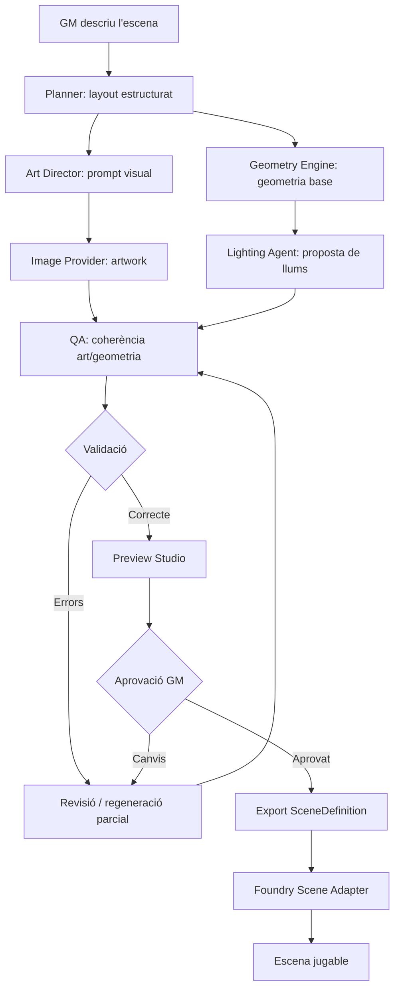

# Objectiu

Afegir a AI Game Master un **Scene Studio** per generar escenes 2D jugables —mapa, parets, portes, il·luminació i ambient— i revisar-les abans d'importar-les a Foundry VTT.

El primer cas d'ús és un mapa top-down d'una taverna medieval de fantasia. La funcionalitat, però, ha de ser genèrica: tavernes, masmorres, cases, carrers, temples i altres escenaris de rol.

Aquesta proposta s'integra en el backend i el mòdul Foundry existents. No crea una segona aplicació, un segon backend ni un segon mòdul Foundry.

## Decisions d'arquitectura

1. **Backend-first:** la generació, la coordinació dels agents, la validació i la gestió d'artefactes viuen a `master-server`.
2. **Un únic model canònic:** `SceneDefinition` descriu l'escena sense dependre de Foundry. Un adaptador del mòdul converteix aquest model en documents Foundry.
3. **Imatge i geometria separades:** la imatge és l'art del mapa; les parets, portes, finestres i llums són dades estructurades. No s'intenta deduir la geometria definitiva només a partir de píxels.
4. **Coordenades compartides:** art i geometria comparteixen un sistema de coordenades explícit i una mateixa mida de canvas.
5. **Revisió humana obligatòria:** generar no implica importar. El GM pot revisar, editar i aprovar abans de crear l'escena.
6. **Orquestració determinista:** els agents proposen artefactes; un orquestrador controla estats, versions, validacions i dependències.
7. **Foundry és el destí d'importació:** el backend no escriu a la base de dades de Foundry. La creació de documents es fa des del mòdul mitjançant l'API pública de Foundry.

## Integració amb el repositori actual

### Backend: `master-server`

Paquet proposat: `dev.agiro.masterserver.scene`.

Separació interna recomanada:

| Paquet | Responsabilitat |
|---|---|
| `domain` | `SceneProject`, `SceneDefinition`, artefactes, versions, estats i regles de domini. |
| `application` | Casos d'ús: crear projecte, generar, revisar, validar, aprovar i exportar. |
| `agent` | Agents especialitzats i els seus contractes d'entrada/sortida. |
| `geometry` | Motor determinista de geometria i validadors topològics. |
| `provider` | Ports i adaptadors per a LLM, generació d'imatges i emmagatzematge d'assets. |
| `persistence` | Entitats/repositoris de projectes, execucions i versions d'artefactes. |
| `web` | Controlador REST i DTOs d'entrada/sortida. |

No cal afegir una tecnologia de cues nova a la primera versió. Les execucions s'han de persistir com a tasques amb estat, i executar-se amb un executor controlat. Si el volum real ho exigeix més endavant, es podrà introduir una cua sense canviar el contracte de domini.

### Foundry: `master-foundry`

Mantenir el mòdul `ai-gm` i afegir-hi:

| Àrea | Fitxers proposats | Responsabilitat |
|---|---|---|
| UI | `src/ui/scene-studio-application.ts`, `src/ui/scene-studio-panel.ts` | Formulari, estat de generació, previsualització i aprovació. |
| Tipus | `src/types/scene.ts` | Contractes TypeScript equivalents al JSON canònic. |
| API | `src/services/scene-api.ts` | REST per a projectes, versions i artefactes. |
| Importació | `src/services/foundry-scene-importer.ts` | Traducció a documents de Foundry i creació de l'escena. |
| Vista prèvia | `src/ui/scene-preview/` | Capes d'art i geometria, selecció i edició bàsica. |

La inicialització de `main.ts` ha de registrar la nova aplicació seguint el patró de `GenerateApplication`, `SessionApplication` i les altres aplicacions actuals. El manifest `module.json` s'ha d'actualitzar amb la plantilla nova.

**No afegir React ni un segon frontend d'entrada.** El projecte compila amb `tsc` i no declara bundler. Per a la primera versió, la previsualització es pot implementar amb SVG/Canvas dins la UI existent. Una llibreria de canvas només s'hauria d'afegir després d'un prototip que demostri que les eines natives no són suficients.

### Comunicació

Reutilitzar REST per a ordres i lectura de recursos, i STOMP per a notificacions de progrés.

El repositori ja disposa de:
- `WebSocketMessage` amb `type`, `sessionId`, `payload`, `error` i `timestamp`.
- Events `IMAGE_GENERATION_STARTED`, `IMAGE_GENERATION_COMPLETED` i `IMAGE_GENERATION_FAILED`.
- Subscripció Foundry a `/queue/image-{sessionId}` i dispatch dels tres events al `WebSocketClient`.

Per tant, no s'ha de crear un canal SSE ni un client WebSocket paral·lel. Es pot ampliar el protocol amb events de projecte/escena quan sigui necessari, però cal mantenir l'embolcall existent i evitar reutilitzar els events d'imatge per a fases que no siguin generació d'imatges.

El DTO `ImageGenerationEvent` existent només demostra que hi ha un contracte previst per a imatges; durant la inspecció no s'ha localitzat un servei complet de generació d'imatges. Cal implementar o adaptar aquest servei després de definir el port del proveïdor.

## Model de domini canònic

El model és independent de Foundry i es versiona explícitament. Tots els identificadors són estables dins del projecte. Les coordenades tenen origen a dalt a l'esquerra i es mesuren en píxels respecte de la imatge final.

### Estructura conceptual

```text
SceneProject
  id, worldId, title, brief, status
  currentVersion
  versions[]
    SceneDefinition
    artwork asset
    validation report
    generation metadata

SceneDefinition
  schemaVersion
  canvas
  grid
  rooms[]
  walls[]
  doors[]
  windows[]
  lights[]
  sounds[]
  props[]
  metadata
```

### Exemple simplificat de `SceneDefinition`

```json
{
  "schemaVersion": "1.0",
  "id": "tavern-main",
  "name": "La darrera llanterna",
  "canvas": {
    "width": 4200,
    "height": 2800,
    "backgroundAssetId": "asset-artwork-v1"
  },
  "grid": {
    "type": "square",
    "columns": 30,
    "rows": 20,
    "distance": 5,
    "unit": "ft"
  },
  "rooms": [
    {
      "id": "common-room",
      "name": "Sala principal",
      "polygon": [[280, 280], [2520, 280], [2520, 1960], [280, 1960]]
    }
  ],
  "walls": [
    {
      "id": "wall-north-1",
      "a": [280, 280],
      "b": [2520, 280],
      "type": "wall",
      "blocksMovement": true,
      "blocksSight": true,
      "blocksLight": true,
      "blocksSound": false
    }
  ],
  "doors": [
    {
      "id": "entrance",
      "wallId": "wall-west-1",
      "start": 0.35,
      "end": 0.55,
      "state": "closed",
      "locked": false
    }
  ],
  "windows": [],
  "lights": [
    {
      "id": "fireplace-light",
      "position": [1960, 1120],
      "brightRadius": 140,
      "dimRadius": 420,
      "color": "#ff9b45",
      "intensity": 0.65,
      "animation": {
        "type": "torch",
        "speed": 3,
        "intensity": 4
      }
    }
  ],
  "sounds": [],
  "props": []
}
```

Aquest exemple és il·lustratiu, no és encara un JSON Schema normatiu ni un contracte implementat. Abans d'implementar-lo cal tancar els camps i les unitats de cada tipus.

### Regles del model

- La mida de la imatge és la mida real del canvas del domini. Si el proveïdor retorna una altra resolució, el backend ha de normalitzar/cropar la imatge o transformar totes les coordenades amb una transformació explícita.
- El grid és metadada de joc; no s'ha de pintar dins la imatge generada.
- Les parets són segments. Les portes i finestres defineixen obertures referenciades a un segment mitjançant coordenades relatives normalitzades `start/end`.
- El motor geomètric divideix els segments de paret al voltant de les obertures. No hi pot haver una paret contínua bloquejant una porta.
- Les llums són entitats independents de l'art. No s'han de confiar a la imatge ni inferir-se'n automàticament com a geometria definitiva.
- Els noms de tipus del domini no han de copiar els enums interns de Foundry. La conversió es concentra a l'adaptador.
- Cada versió aprovada és immutable. Les modificacions creen una versió nova.

## Flux de generació



### Agents i responsabilitats

| Component | Entrada | Sortida | Restriccions |
|---|---|---|---|
| `PlannerAgent` | Brief i restriccions | Layout semàntic: sales, accessos, fluxos i punts d'interès | No genera coordenades Foundry ni escriu a persistència. |
| `ArchitectAgent` | Layout | Proposta de geometria estructurada | La sortida passa pel Geometry Engine. |
| `ArtDirectorAgent` | Brief i layout | Prompt visual i instruccions de composició | Ha de preservar accessos i zones funcionals. |
| `ImageGenerationProvider` | Prompt, mida i referències | Asset d'imatge | Adaptador de proveïdor; no acoblar el domini a un fabricant. |
| `LightingAgent` | Layout i geometria | Proposta de llums | No modifica parets ni portes. |
| `QAAgent` | Imatge, layout i geometria | Informe d'incoherències | És assistiu; les regles geomètriques crítiques són deterministes. |
| `GeometryEngine` | Geometria i obertures | Geometria normalitzada i errors | Codi determinista, no un agent LLM. |
| `SceneOrchestrator` | Comandes i artefactes | Estat, versions i següent pas | Únic propietari de les transicions de workflow. |

Un agent no modifica directament l'estat del projecte. Rep una entrada versionada i retorna una proposta versionada. L'orquestrador valida i accepta o rebutja el resultat.

### Estat del workflow

Estats recomanats:

`DRAFT → PLANNING → LAYOUT_READY → GENERATING_ARTWORK → VALIDATING → PREVIEW_READY → APPROVED → EXPORTED`

Estats transversals: `FAILED`, `REVISION_REQUIRED` i `REGENERATING`.

Cal persistir l'estat després de cada pas perquè una fallada no obligui a repetir tota la generació. Cada execució ha de registrar el prompt/brief, la versió del model/proveïdor, els identificadors d'artefactes, el temps i l'error (si n'hi ha).

## API proposada

Els noms són una proposta de contracte; no s'han d'afegir a la documentació general d'API fins que els controladors estiguin implementats.

| Mètode | Ruta | Ús |
|---|---|---|
| `POST` | `/api/scenes` | Crear projecte a partir del brief. |
| `POST` | `/api/scenes/{projectId}/generate` | Iniciar o reprendre generació. |
| `GET` | `/api/scenes/{projectId}` | Recuperar projecte, estat i versió actual. |
| `GET` | `/api/scenes/{projectId}/versions/{version}` | Recuperar definició i metadades d'una versió. |
| `PATCH` | `/api/scenes/{projectId}/definition` | Desar canvis manuals com una versió nova. |
| `POST` | `/api/scenes/{projectId}/validate` | Executar validació. |
| `POST` | `/api/scenes/{projectId}/approve` | Aprovar una versió concreta. |
| `GET` | `/api/scenes/{projectId}/export` | Obtenir paquet d'importació. |

Els events STOMP s'han d'adreçar a una subscripció específica del projecte o execució. Payload mínim: `projectId`, `runId`, `phase`, `status`, `progress` opcional i referència a l'artefacte/resultat. No enviar imatges base64 pel WebSocket: enviar identificadors o URLs d'assets protegides.

## Persistència i assets

- PostgreSQL: projectes, propietat/món, estats, versions, execucions, metadades i informes.
- Emmagatzematge d'objectes o filesystem configurable: PNG/WebP, miniatures, prompts i paquets exportats.
- La base de dades desa referències i hashes, no blobs d'imatge grans.
- Cada artefacte té identificador, tipus, versió, ubicació, hash, mida i metadades del proveïdor.
- La primera implementació pot utilitzar el filesystem local configurable; el domini no ha de dependre d'aquesta decisió.
- Validar tipus MIME, dimensions, mida màxima i noms/rutes dels fitxers. No acceptar paths arbitraris del client.

## Importació a Foundry VTT

L'adaptador viu exclusivament al mòdul Foundry i és responsable de:

1. Crear un `Scene` amb amplada/alçada, grid, escala i configuració de visibilitat.
2. Assignar la imatge de fons a la ruta d'asset accessible des de Foundry.
3. Convertir parets i obertures a documents de paret.
4. Convertir llums a documents de llum ambiental.
5. Crear sons i elements addicionals quan estiguin suportats.
6. Retornar el document creat i informar d'errors parcials.

La importació ha de ser idempotent respecte del paquet aprovat: evitar duplicar una escena si l'usuari repeteix l'acció. No s'ha de sobreescriure una escena existent sense confirmació explícita.

**Compatibilitat:** `module.json` declara `verified: 14`, però `package.json` encara depèn de `@league-of-foundry-developers/foundry-vtt-types ^12.331.5`. Abans d'implementar l'adaptador cal actualitzar/verificar els tipus i provar les signatures reals de Foundry 14. No s'ha de prendre la declaració del manifest com a prova que totes les API ja estan tipades o verificades.

## Validació i qualitat

### Validació determinista

- Coordenades dins del canvas.
- IDs únics i referències existents.
- Polígons vàlids i no degenerats.
- Segments de paret amb longitud positiva.
- Portes/finestres associades a parets vàlides i dins dels seus límits.
- Cap obertura solapada de manera inconsistent.
- Parets dividides al voltant de portes i finestres.
- Llums dins del canvas i amb radis vàlids.
- Grid i escala coherents amb les dimensions.
- Cap entitat crítica fora de l'escena.

### QA visual assistit

L'agent QA pot detectar:
- parets que no coincideixen amb l'art,
- portes que visualment no semblen accessibles,
- mobiliari que tapa accessos,
- llums sense font visual plausible,
- etiquetes, text o quadrícules incrustades a la imatge,
- diferències de composició entre el layout aprovat i l'art final.

Els resultats s'han de presentar com a avisos/recomanacions revisables, no com a veritat geomètrica.

## Regeneració parcial

Cada artefacte ha de declarar les dependències de la versió que l'ha produït. Exemples:

| Canvi | Artefactes que cal regenerar |
|---|---|
| Canviar estil artístic | Prompt d'art i imatge; mantenir geometria. |
| Moure una porta | Geometria i validació; revisar art si la porta és visible. |
| Afegir una llar de foc | Layout, art, geometria si afecta parets i llums. |
| Canviar color/intensitat d'una llum | Llums i paquet d'exportació. |
| Canviar el grid/escala | Conversió de coordenades i exportació; no necessàriament la imatge. |
| Canviar la versió de Foundry | Adaptador/exportació i proves d'importació. |

Cal calcular hashes dels inputs per evitar regenerar artefactes que no han canviat.

## Pla d'implementació incremental

L'ordre prioritza demostrar que una escena és importable abans d'invertir en una arquitectura multiagent.

### Fase 1 — Importació mínima a Foundry

- Definir un JSON manual petit amb imatge de prova, canvas, grid, parets, una porta i una llum.
- Implementar `FoundrySceneImporter`.
- Crear una escena nova a Foundry 14 i verificar-la visualment i funcionalment.
- Cobrir errors i reexecució sense duplicats.

**Criteri de sortida:** una escena creada des del mòdul té imatge, grid, parets, porta i llum correctes.

### Fase 2 — Domini i geometria

- Implementar `SceneDefinition` i JSON Schema versionat.
- Implementar `GeometryEngine` i validadors.
- Afegir tests unitaris per coordenades, obertures i casos límit.
- Exportar/importar un paquet independent del proveïdor d'IA.

**Criteri de sortida:** una definició vàlida es pot validar, versionar i importar de manera repetible.

### Fase 3 — Scene Studio i edició

- Afegir aplicació Foundry per crear projectes i revisar versions.
- Mostrar imatge, grid opcional i capes de geometria.
- Permetre com a mínim moure/crear parets i portes i editar llums.
- Desar els canvis com una versió nova.

**Criteri de sortida:** el GM pot corregir una escena sense regenerar-la.

### Fase 4 — Generació assistida

- Definir ports de LLM i generació d'imatges.
- Implementar Planner, Art Director i proveïdor d'imatges.
- Persistir execucions i artefactes.
- Enviar progrés amb STOMP.

**Criteri de sortida:** un brief genera layout i artwork revisables, sense importació automàtica.

### Fase 5 — Agents complementaris i QA

- Afegir Architect/Lighting agents només on aportin valor.
- Implementar QA visual i regeneració parcial.
- Afegir mètriques, límits de cost, timeout, cancel·lació i recuperació.

**Criteri de sortida:** les iteracions parcials conserven els artefactes no afectats i l'escena passa els validadors.

### Fase 6 — Ambientació

- Sons ambientals i punts d'àudio.
- Animacions de llum i efectes visuals compatibles.
- Biblioteca d'elements reutilitzables i presets d'estils.
- Formats d'exportació addicionals si hi ha demanda.

## Decisions pendents abans del codi

1. Proveïdor inicial de generació d'imatges i si ha de funcionar també en local.
2. Resolució màxima, proporció i estratègia de normalització de les imatges.
3. On s'emmagatzemen els assets en desenvolupament i en desplegament.
4. Si la primera versió d'edició necessita moure nodes/segments o només ajustar valors.
5. Quin conjunt exacte d'API de Foundry 14 es vol suportar per a parets, portes, llums i sons.

Aquestes decisions no bloquegen la Fase 1: es pot provar la importació amb una imatge estàtica i un JSON manual.

## Riscos i no-objectius inicials

- No construir un editor gràfic complet abans de demostrar la importació.
- No permetre que un LLM defineixi directament coordenades finals sense normalització i validació.
- No acoblar `SceneDefinition` a classes de Foundry.
- No introduir Kafka, RabbitMQ, Spring Batch ni una segona aplicació per a aquest flux inicial.
- No enviar imatges grans com a payload STOMP.
- No prometre compatibilitat amb Foundry 14 fins que els tipus i les proves d'integració s'hagin actualitzat.
